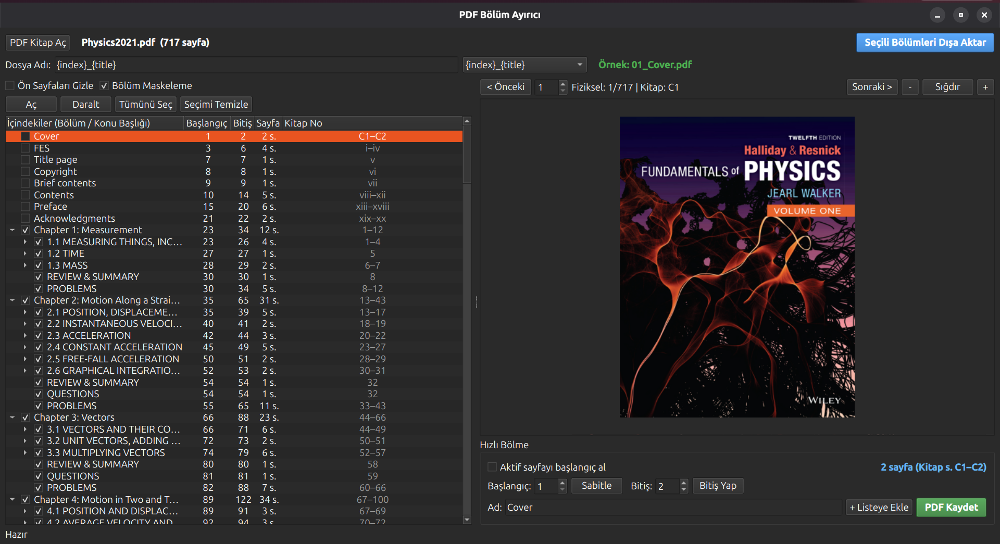

# PDF Bölüm Ayırıcı (PDF Chapter Splitter)



Ders kitapları ve teknik PDF dokümanlarını gömülü içindekiler (TOC) hiyerarşisine veya özel sayfa aralıklarına göre bağımsız PDF dosyalarına ayıran, **Python**, **PySide6** ve **PyMuPDF** tabanlı masaüstü uygulaması.

## Özellikler

- **Hiyerarşik İçindekiler Ağacı:** PDF içindeki yer imlerini (bölüm ve alt konu başlıklarını) fiziksel sayfa numaraları, sayfa adetleri ve kitabın kendi sayfa etiketleriyle birlikte ağaç yapısında listeler.
- **Otomatik Ön Sayfa Filtreleme:** Kapak (`C`), içindekiler, önsöz ve Roma rakamlı (`i`, `ii`, `iv`...) ön sayfaları otomatik tespit ederek gizler ve toplu dışa aktarım dışında bırakır.
- **Bölüm Maskeleme:** Sayfa ortasında başlayan alt konuların üst kısmında kalan önceki konuya ait metinleri ve geçiş sayfasındaki sonraki konunun alt kısmını PyMuPDF içerik katmanından temizleyerek yalnızca ilgili bölümü bırakır.
- **Canlı Sayfa Önizleme ve Hızlı Bölme:** Arka plan iş parçacığı (`QThreadPool`) ve bellek önbelleği destekli sayfa görüntüleyici üzerinden başlangıç/bitiş sayfalarını anlık olarak belirleme, listeye ekleme veya tek dosya olarak kaydetme imkânı sunar.
- **Özelleştirilebilir Dosya Adı Şablonları:** `{index}`, `{title}`, `{book}`, `{start}`, `{end}` ve `{label}` değişkenleriyle çıktı dosyalarını otomatik olarak adlandırır.

## Proje Yapısı

```text
pdf-chapter-splitter/
├── core/
│   ├── __init__.py
│   ├── models.py           # Bölüm veri modelleri
│   └── pdf_processor.py    # PyMuPDF analiz, render, maskeleme ve bölme motoru
├── ui/
│   ├── __init__.py
│   ├── main_window.py      # Ana pencere ve kontrol arayüzü
│   └── widgets.py          # Yakınlaştırma destekli sayfa önizleme bileşeni
├── main.py                 # Uygulama giriş noktası
├── requirements.txt        # Bağımlılık listesi
├── LICENSE                 # MIT Lisansı
└── README.md
```

## Kurulum ve Çalıştırma

1. Depoyu klonlayın ve proje dizinine geçin:
   ```bash
   git clone https://github.com/ZayuR3X/pdf-chapter-splitter.git
   cd pdf-chapter-splitter
   ```

2. Sanal ortam oluşturup etkinleştirin:
   ```bash
   python3 -m venv .venv
   source .venv/bin/activate
   ```

3. Gerekli paketleri kurun ve uygulamayı başlatın:
   ```bash
   pip install -r requirements.txt
   python main.py
   ```

## Kullanım

- **Toplu Bölüm Ayırma:** Sol paneldeki içindekiler ağacından dışa aktarmak istediğiniz bölüm veya alt konuları işaretleyin, üst çubuktan dosya adı şablonunu belirleyin ve **Seçili Bölümleri Dışa Aktar** butonuna tıklayın.
- **Hızlı Manuel Aralık:** Sağ panelde sayfalar arasında gezinirken aktif sayfa otomatik olarak başlangıç seçilir; **Sabitle** ve **Bitiş Yap** butonlarıyla istediğiniz aralığı belirleyip doğrudan **PDF Kaydet** ile dışa aktarabilir veya **+ Listeye Ekle** ile toplu listeye dahil edebilirsiniz.

## Lisans

Bu proje [MIT Lisansı](LICENSE) altında lisanslanmıştır.