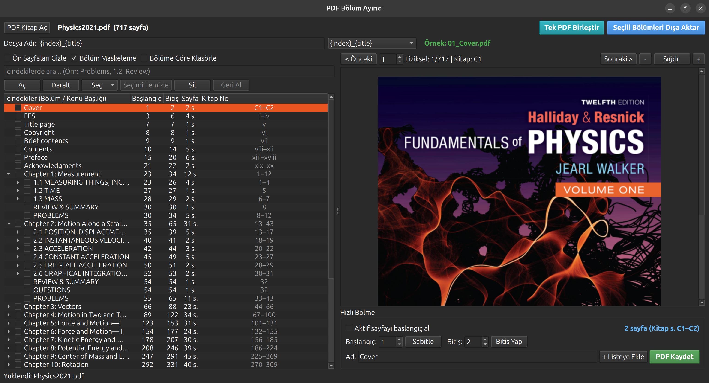

# PDF Chapter Splitter by ZayuR3X

**PySide6** ve **PyMuPDF** kullanılarak geliştirilmiş; kalın ders kitaplarını, teknik dokümanları ve akademik kaynakları içindekiler tablosu (TOC) veya özel sayfa aralıklarına göre hızlıca bölümlere ayıran çapraz platform (Linux, Windows, macOS) masaüstü uygulaması.



## Özellikler

- **Hiyerarşik İçindekiler Ağacı ve Canlı Arama:** Gömülü yer imlerini (TOC) bölüm ve alt konu hiyerarşisiyle listeler; anlık arama kutusuyla yüzlerce başlık arasında hızlı filtreleme sağlar.
- **Akıllı Bölüm Maskeleme:** Sayfa ortasında başlayan konuların üst kısmındaki önceki konuya ait metinleri ve geçiş sayfasındaki sonraki konunun başlangıcını otomatik temizler.
- **Toplu Dışa Aktarma ve Klasörleme:** İşaretli bölümleri arka planda arayüzü dondurmadan ayrı PDF dosyaları olarak dışa aktarır; isteğe bağlı olarak alt konuları bağlı oldukları ana bölüm klasörleri altında gruplar.
- **Tek PDF Birleştirme:** Ağaçtan seçilen (ardışık olması gerekmeyen) birden fazla bölümü, yeni sayfa numaralarına göre oluşturulmuş içindekiler tablosuyla (TOC) tek bir çalışma PDF'inde birleştirir.
- **Hızlı Bölme ve Canlı Önizleme:** Gömülü içindekiler tablosu bulunmayan veya özel aralık gerektiren PDF'lerde sayfa önizlemesi üzerinden başlangıç/bitiş belirleyerek anında PDF kaydeder.
- **Esnek Düzenleme ve Kısayollar:** Sürükle-bırak ile PDF açma, çift tıklamayla satır içi başlık düzenleme, çok adımlı silme geri alma (`Ctrl+Z`), akıllı seçim menüsü (`Ana Bölümleri Seç`, `Görünür Tümünü Seç`) ve son kullanılan klasörleri hatırlama desteği sunar.
- **Özelleştirilebilir Dosya Adlandırma:** `{index}`, `{title}`, `{book}`, `{start}`, `{end}` ve `{label}` değişkenleriyle dinamik çıktı dosya adları oluşturur.

## Kurulum ve Çalıştırma

### Gereksinimler
- Python 3.10 veya üzeri

### Linux / macOS
```bash
git clone https://github.com/ZayuR3X/pdf-chapter-splitter.git
cd pdf-chapter-splitter
python3 -m venv .venv
source .venv/bin/activate
pip install -r requirements.txt
python main.py
```

### Windows (CMD / PowerShell)
```cmd
git clone https://github.com/ZayuR3X/pdf-chapter-splitter.git
cd pdf-chapter-splitter
python -m venv .venv
.venv\Scripts\activate
pip install -r requirements.txt
python main.py
```

## Lisans

Bu proje [MIT Lisansı](LICENSE) altında lisanslanmıştır.